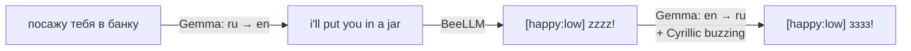
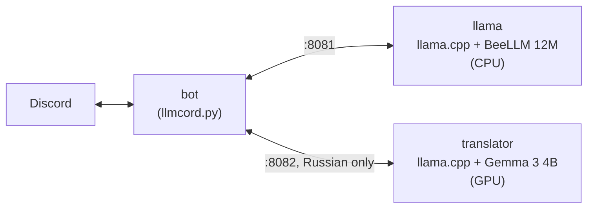

<h1 align="center">
  scintilla bee 🐝
</h1>

<h3 align="center"><i>
  A Discord bee who only buzzes. Now in Russian too.
</i></h3>

Scintilla is a Discord bot running [BeeLLM-2.0-12M-Mood](https://huggingface.co/schizophyllume/BeeLLM), a tiny
12-million-parameter language model trained to be a bee. She doesn't answer questions or follow instructions: she
reads your message, picks a mood, and buzzes at you.

It's a fork of [llmcord](https://github.com/jakobdylanc/llmcord) with a few patches for the model's quirks, plus a
second, bigger model that translates Russian for her.

## Talking to her

@mention her to start a conversation, and reply to her messages to continue it. In DMs you can just talk.

Every reply starts with a `[mood:level]` tag (like `[happy:high]`, `[loving:low]`, `[confused:low]`, `[angry:low]`),
followed by buzzing and sometimes an *action*:

> **you:** @Scintilla hi scintilla!<br>
> **Scintilla:** [happy:high] bizz!zzz *flies over when you say Scintilla*

> **you:** @Scintilla \*hands you a flower\*<br>
> **Scintilla:** [happy:low] brrr~ buzz buzz!

> **you:** @Scintilla put u in jar<br>
> **Scintilla:** [angry:low] *stings you* GRRRR BZZzzZZZ!

> **you:** @Scintilla yayyy! \*hands over 5 cans of Scintilla\*<br>
> **Scintilla:** [happy:high] zzzz! *does a victory lap does a victory lap*

(Real replies, but she's random: ask twice and you'll get different buzzes.)

She remembers the reply chain, so a conversation can go on for a while, but her memory is short: only the last
8 messages are sent to her.

## Russian

BeeLLM only learned English. Russian text means nothing to her, so she'd buzz neutrally or confused at everything. Instead,
messages with Cyrillic go through a translator (Gemma 3 4B) on the way in, and her reply goes through it again on
the way out:




| You write                                             | She reads                           | She says                              | You see                                                     |
| ----------------------------------------------------- | ----------------------------------- | ------------------------------------- | ----------------------------------------------------------- |
| привет, пчёлка! как дела?          | hi, little bee! how are you?        | [neutral:low] bzz. hi.                | [neutral:low] бзз. хи.                                 |
| ты самая милая пчела на свете | you're the cutest bee in the world  | [loving:low] mmbzz~ bzz~              | [loving:low] ммбзз~ бзз~                            |
| \*гладит по пушистой спинке\*   | \*petting your fluffy back\*        | [happy:low] bzz! zip zip! yay!        | [happy:low] бзз! зип зип! йай!                  |
| сейчас прихлопну тебя тапком | i'm gonna smash you with a shoe now | [angry:low] AAAAAAAA BZZZZZZZZZBZZT… | [angry:low] АААААААА БЗЗЗЗЗЗЗЗЗБЗЗТ… |

When she uses real words, they get translated too:

> **Scintilla:** [happy:high] builds a tiny nest on the honey zips around like a tiny comet zip zip<br>
> **→** [happy:high] строит крошечное гнёздышко на мёде зипс вокруг как крошечная комета зип зип

Words the translator leaves in English get spelled in Cyrillic too ("zips" → "зипс", "hi" → "хи"), which suits her.

How it fits together:

- Only messages with Cyrillic are translated. English messages go straight to her and back, unchanged.
- The `[mood:level]` tag is never translated.
- Gemma is told to translate exactly what's written and add nothing. BeeLLM is very sensitive to extra text: an
  added "bzz" or emoji changes her mood.
- Bee sounds are copied by Gemma letter for letter, then spelled in Cyrillic by code (`bzz zip` → `бзз зип`,
  `BZZT` → `БЗЗТ`), so she buzzes in Russian without the translator inventing or dropping buzzes.
- The conversation history keeps her original English reply, so she always reads English.
- If the translator is down, she just gets the untranslated message, and the reply stays in English.

## How it works



What happens with one message:

1. Someone @mentions her. The bot walks the reply chain to collect the conversation (up to 8 messages).
2. Messages with Cyrillic are translated to English. Each message is translated once and cached.
3. The bot sends the conversation to BeeLLM, with the reply already started with `[` (see below).
4. If the message was in Russian, the reply is translated back.
5. The reply is posted as a normal Discord message.

### Patches over llmcord

BeeLLM is a toy model with some sharp edges, so the bot works around them:

- **No user ID prefixes.** llmcord writes `<@1234>: hello` so a model can tell users apart. BeeLLM answered that
  with `[angry:low] BZzZzZZZ` every time, so messages are sent as plain text.
- **Reply prefill.** Some messages (e.g. "put u in jar") made her end her reply before writing anything, so the bot
  just showed "typing" and sent nothing. Every reply now starts with `[`, which forces her to pick a mood.
- **No system prompt.** Her chat template has no place for one; she is who she is.
- **Bot-to-bot, with a limit.** Other bots can talk to her, but only by @mentioning her in the message text, and at
  most 5 times per minute per channel, so two bots can't loop forever.
- **Plain messages.** Replies are sent as normal message text instead of embeds, so every Discord client shows them.

Details are in [SCINTILLA.md](SCINTILLA.md).

## Running it

You need a Discord application with a bot token (see [SCINTILLA.md](SCINTILLA.md#discord-setup)), then:

```sh
cp .env.example .env     # fill in DISCORD_BOT_TOKEN and DISCORD_CLIENT_ID
docker compose up -d --build
docker compose logs bot  # prints the invite URL
```

This starts three containers:


|              | Model                   | Needs                                                                                                                                                                       | Memory      |
| ------------ | ----------------------- | --------------------------------------------------------------------------------------------------------------------------------------------------------------------------- | ----------- |
| `llama`      | BeeLLM 12M (46 MB)      | any CPU                                                                                                                                                                     | ~64 MiB RAM |
| `translator` | Gemma 3 4B Q4 (~2.5 GB) | NVIDIA GPU with 4 GB VRAM (e.g. GTX 1650 Ti) and the[NVIDIA Container Toolkit](https://docs.nvidia.com/datacenter/cloud-native/container-toolkit/latest/install-guide.html) | ~3 GB VRAM  |
| `bot`        |                         |                                                                                                                                                                             | ~80 MiB RAM |

BeeLLM is fast: one reply takes about 12 ms on a CPU. A Russian message adds about a second for the two
translations.

No GPU? Delete the `translator` service from `docker-compose.yaml` and the `translator:` block from
`config.yaml`. She'll work fine, just in English only.

Settings live in [config.yaml](config.yaml) and are reloaded on every message, so you can change them without
restarting.

## Credits

- [llmcord](https://github.com/jakobdylanc/llmcord) by jakobdylanc: the bot this is built on
- [BeeLLM](https://huggingface.co/schizophyllume/BeeLLM) by schizophyllume: the bee
- [Gemma 3](https://huggingface.co/google/gemma-3-4b-it) by Google: the translator
- [llama.cpp](https://github.com/ggml-org/llama.cpp): runs both models

License: [MIT](LICENSE.md) (llmcord). BeeLLM is Apache 2.0, Gemma 3 is under the
[Gemma Terms of Use](https://ai.google.dev/gemma/terms).
