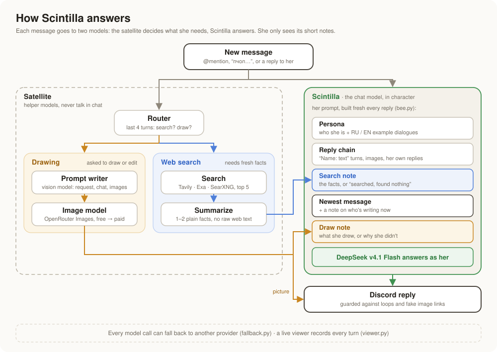

<h1 align="center">
  scintilla bee 🐝
</h1>

<h3 align="center"><i>
  A Discord bee who buzzes in every phrase. In Russian and English.
</i></h3>

Scintilla is a Discord bot: a girl bee who talks to everyone like a teasing old buddy, buzzes more than she talks, and
panics at slippers, jars and nets. She sees images, knows who's who in the chat, looks things up on the web when a
question needs fresh facts, and draws pictures when asked.

She runs on any OpenAI-compatible chat model. She was tuned and tested on DeepSeek v4.1 Flash. The bot is a fork of
[llmcord](https://github.com/jakobdylanc/llmcord); her persona is in [bee.py](bee.py), the web search in
[satellite.py](satellite.py) and drawing in [imagegen.py](imagegen.py).

## Talking to her

@mention her, or call her by name ("пчол...", "bee"), to start a conversation. Reply to her messages to continue it.
In DMs you can just talk.

> **Миша:** как дела?<br>
> **Scintilla:** бзззз~ да норм, Миша, бзз, солнышко, нектар, бжжж. сам как, бзбзз?

> **Тёма:** кто написал войну и мир?<br>
> **Scintilla:** бзз, Толстой, бззз. Лев, бзбзз. классика же, бжж

> **Петя:** кто выиграл последний чм по футболу?<br>
> **Scintilla:** бззз Испания, Петь, бззз. аргентинцев в допах дожали, бжжж

She answers in the language of your message and only snaps back at people who are rude to her. Her memory is the reply
chain (the last `max_messages` messages).

## How she works



The **satellite** is a second, short model call. Its output never goes to Discord. It decides whether the newest message
needs the web. If it does, it searches and boils the results down to one or two plain facts. Raw web pages never reach
her prompt, so instructions hidden in them can't steer her. She doesn't call tools herself, so her tuned prompt stays
untouched.

The satellite also notices requests to **draw** ("нарисуй…", "draw…", "замени текст на картинке…"). Then `imagegen.py`
has a vision model write an image prompt from the request, the chat and any attached picture, an image model draws it,
and the picture goes out with her reply. The image model is text-to-image only, so changing a picture means redrawing it
from a description. Her drawing's prompt stays with her message, so "make it blue" as a reply changes that drawing.

The **chat model** is the bee. Her prompt is built fresh for every reply (`bee.py`):

- **System context.** The persona, plus example dialogues as earlier chat turns. Her buzzing comes from those
  examples, not from rules: inside the system prompt the model copied them word for word and looped. Russian and English
  have separate sets.
- **Message history.** The reply chain, each user turn as "Name: text" with @mentions as `@Name`, so she tells people
  apart. It's her whole memory.
- **Current turn.** It comes with a note on who's writing now, so one person's insults don't spill over to everyone else.
- **Bee's response.** A loop guard cuts runaway repeats ("ббббббб…") before it's sent.

## Running it

You need:

- a Discord application with a bot token (see [SCINTILLA.md](SCINTILLA.md#discord-setup))
- an OpenAI-compatible endpoint with a chat model (with vision if you want her to see images)
- optionally, a Tavily or Exa key for search. Without one she uses the bundled SearXNG.
- optionally, an OpenRouter key for drawing (`OPENROUTER_API_KEY`).

```sh
cp .env.example .env     # Discord token and client ID, your model API key, search keys
$EDITOR config.yaml      # providers:, models:, bee_models:, satellite:, imagegen:
docker compose up -d --build
docker compose logs bot  # prints the invite URL
```

`config.yaml` is re-read on every message, so you can change most settings without a restart. The first model under
`models:` is the default, and changing it takes a restart.

| Setting | What it does |
|---|---|
| `providers:` / `models:` | Where the chat model lives and its params (`temperature`, `max_tokens`, …) |
| `bee_models:` | Models that get Scintilla's prompt and examples (`system_prompt` is skipped for them) |
| `:vision` suffix | On a model name: send images to it (stripped before the API call) |
| `satellite:` | The web search step: `model`, `search` (`tavily`, `exa`, `searxng`), `results`, `timeout`. Delete the block to turn it off |
| `imagegen:` | Drawing: `writer` (vision model for the image prompt), `model` (OpenRouter image model), `style`, `per_user_per_hour`. Needs `satellite:`. Delete the block to turn it off |
| `max_messages`, `max_images` | How far back the reply chain goes, how many images ride along |
| `history_since` | ISO time: older messages are left out of every chain (a history reset) |
| `min_reply_delay` | She replies no sooner than this many seconds after a message, showing "typing…" meanwhile |
| `allow_bots`, `max_bot_replies_per_minute` | Other bots can talk to her, only with an @mention in the text, capped per channel |

Without Docker: `uv venv && uv pip install -r requirements.txt && .venv/bin/python llmcord.py` (search then needs
Tavily/Exa, or a SearXNG at `satellite.searxng_url`).

## Changes from llmcord

- Her persona, examples, "Name: text" turns, the speaker hint and the loop guard (`bee.py`).
- The satellite: an optional web-search note for each reply (`satellite.py`).
- Drawing on request, the picture attached to her reply (`imagegen.py`).
- Answers when called by name, not only on @mention.
- Stickers and attachments she can't see turn into a short note ("(прислали стикер «name», ты его не видишь)"),
  so an empty message doesn't confuse her.
- `history_since`, `min_reply_delay`, `prefix_user_ids: false`, and bot-to-bot replies with a per-channel cap.
- Plain message content instead of a Components V2 `TextDisplay`, which some clients (e.g. Swiftcord) show as empty.

The diff to `llmcord.py` is kept small so upstream changes merge easily. Setup notes and history: [SCINTILLA.md](SCINTILLA.md).

## Credits

- [llmcord](https://github.com/jakobdylanc/llmcord) by jakobdylanc: the bot this is built on
- [BeeLLM](https://huggingface.co/schizophyllume/BeeLLM) by schizophyllume: the original bee (until 2026-11-11)

License: [MIT](LICENSE.md) (llmcord).
